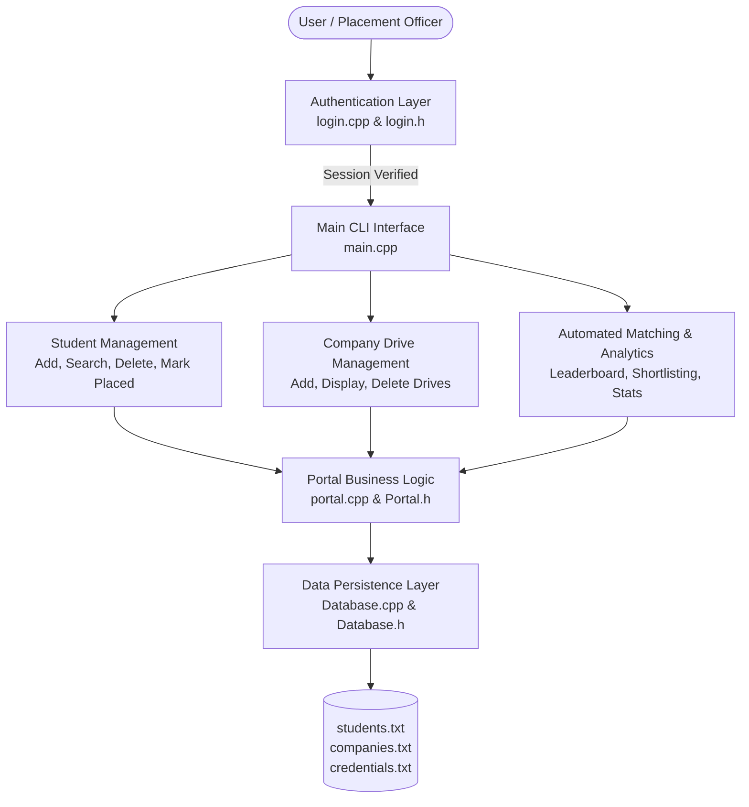

# 🎓 Smart Placement Portal

[](https://isocpp.org/)
[]()
[]()
[]()

**Smart Placement Portal** is a production-grade, modular C++ campus recruitment management and decision-support system. It empowers placement coordinators, university training & placement offices (TPO), and recruiting companies to manage student academic records, automate job drive eligibility screening, rank candidates using multi-tier tie-breakers, and compute comprehensive recruitment analytics.

---

## 🏛️ System Architecture



---

## ✨ Key Features & Capabilities

### 1. 🔒 Secure Authentication & Credential Management
* **Persistent Admin Session**: Stores credentials with salt-based XOR password masking (`credentials.txt`).
* **Brute-Force Protection**: Caps consecutive invalid login attempts at 3 before terminating execution.
* **In-App Password Management**: Coordinators can update the admin master password directly from the console.
* **Default Credentials**: `admin` / `admin123`.

### 2. 👨‍🎓 Complete Student Lifecycle Management
* **Record Tracking**: Tracks Student ID, Full Name, Branch (ICT, CSE, ECE, AI, MNC, etc.), CGPA, and Active Backlogs.
* **Search Engine**: Instant lookup by exact Student ID or case-insensitive substring search by student name.
* **Placement Status Synchronization**: Mark students as placed with their hiring company, instantly updating all analytics.
* **Safe Deletion**: Confirmation prompt protects against accidental student record removal.

### 3. 🏢 Recruiting Company Drive Management
* **Drive Specification**: Track recruiting partners, job profiles/roles, minimum CGPA thresholds, maximum allowed backlogs, and offered package (CTC in LPA).
* **Company Catalog**: View tabular breakdown of current campus recruitment drives.

### 4. ⚡ Two-Way Automated Eligibility Engine
* **Student-Centric Check**: Enter any Student ID to instantly reveal all eligible campus drives based on their CGPA and backlog standing.
* **Company-Centric Shortlisting**: Enter a company name to automatically generate a pre-filtered list of qualified candidates ready for online assessments and interviews.

### 5. 👑 Multi-Tier Merit Leaderboard
* Ranks candidates dynamically based on academic standing.
* **Dual Tie-Breaker Logic**:
  1. Primary: Highest CGPA.
  2. Tie-Breaker 1: Lowest active backlogs (prioritizes cleaner academic records).
  3. Tie-Breaker 2: Alphabetical name order.

### 6. 📊 Real-Time Placement Analytics
* Computes real-time key performance indicators (KPIs):
  * Total registered candidates
  * Total placed vs. unplaced counts
  * Placement percentage ratio
  * Highest CTC package secured & recruiting company
  * Average package across placed students

### 7. 🛡️ Robust Fault Tolerance & Input Sanitization
* **Corrupted Record Skipping**: Corrupted lines in database files are isolated using `try-catch` blocks and skipped with line-number warnings without terminating the program.
* **Stream Recovery**: Protects against invalid user input (e.g., typing letters into numeric prompts) via automated `std::cin` buffer clearing, eliminating terminal infinite loops.

---

## 📁 Project Structure

```text
Smart-Placement-Portal/
├── CMakeLists.txt        # Modern CMake C++17 build configuration
├── Database.h            # Persistence layer declarations
├── Database.cpp          # File reading/writing & data sanitization
├── Portal.h              # Student, Company structures & Portal class definition
├── portal.cpp            # Core business logic, ranking & eligibility algorithms
├── login.h               # Authentication system declaration
├── login.cpp             # Login validation & password obfuscation
├── main.cpp              # Interactive menu & orchestration loop
├── .gitignore            # Build artifact exclusions
└── README.md             # Project documentation
```

---

## 🚀 How to Build and Run

### Option 1: Standard G++ (Recommended)

Make sure you have GCC/G++ installed (`g++ --version`).

```bash
# Clone the repository
git clone https://github.com/divyanshu07-code/Smart-Placement-Portal.git
cd Smart-Placement-Portal

# Compile with C++17
g++ -std=c++17 main.cpp portal.cpp Database.cpp login.cpp -o SmartPlacementPortal

# Run the executable
# On Windows:
.\SmartPlacementPortal.exe

# On Linux / macOS:
./SmartPlacementPortal
```

### Option 2: Using CMake

```bash
mkdir build
cd build
cmake ..
cmake --build .

# Run:
./SmartPlacementPortal
```

---

## 💻 Sample Terminal Walkthrough

```text
*********************************************
*    CAMPUS PLACEMENT MANAGEMENT SYSTEM     *
*********************************************

=============================================
          SECURE PORTAL LOGIN               
=============================================
Enter Username : admin
Enter Password : ••••••••

[+] Authentication Successful! Welcome, admin.

=============================================
           SMART PLACEMENT PORTAL            
=============================================
 [STUDENT MANAGEMENT]
   1. Add New Student Record
   2. Display All Students
   3. Search Student (by ID / Name)
   4. Mark Student as Placed
   5. Delete Student Record

 [COMPANY MANAGEMENT]
   6. Add Recruiting Company Drive
   7. Display All Recruiting Companies
   8. Delete Company Drive

 [DRIVE MATCHING & ANALYTICS]
   9. Merit Leaderboard (CGPA & Tie-Breaker)
  10. Check Student Eligibility (by ID)
  11. Generate Company Shortlist (by Company)
  12. Placement Statistics & Analytics

 [SETTINGS & EXIT]
  13. Change Admin Password
  14. Exit Portal
=============================================
```

---

## 👤 Author

**Divyanshu**
* GitHub: [@divyanshu07-code](https://github.com/divyanshu07-code)

---

## 🤝 Contributing & Feedback

Contributions, feature requests, and issue reports are welcome! If you found this project helpful, please give it a **⭐ Star** on GitHub!
